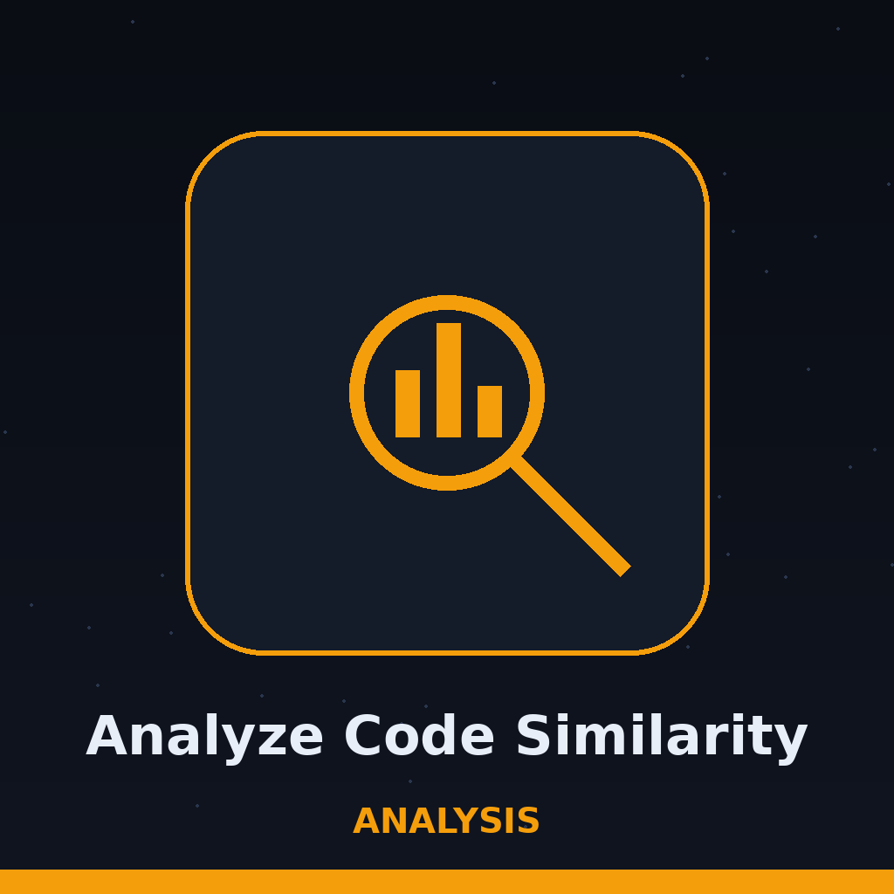

# analyze-code-similarity


<p align="center"></p>


Compares two files and reports a similarity score based on common tokens or lines.

## Install
```sh
git clone https://github.com/ShadowGuard-AI/analyze-code-similarity
cd analyze-code-similarity
```
Standard library only. There are no third party requirements to install.


## Usage
```sh
python3 main.py FILE1 FILE2 [-m token|line] [-t THRESHOLD] [-v]
```


## Parameters
- `FILE1`: path to the first file.
- `FILE2`: path to the second file.
- `-h`: show help message and exit.
- `-m`, `--mode`: comparison mode, `token` (default) or `line`.
- `-t`, `--threshold`: similarity threshold from 0.0 to 1.0. Default: 0.7. Scores below the threshold are reported as dissimilar.
- `-v`, `--verbose`: enable verbose logging.


## Verified behavior
- Identical files score 1.0000 and are reported similar, in both token and line mode.
- Unrelated files score 0.0000 and are reported dissimilar.
- A missing input file exits 1.
- A threshold outside 0.0 to 1.0 prints a message and exits 1.
- The code compares with `>=`, so a score exactly on the threshold counts as similar.
- Limits, from the code: token mode splits on whitespace only, so punctuation stays attached and case counts. Line mode uses sets, so duplicate lines collapse and line order is ignored.


## License
MIT License, see LICENSE.

> Logbook entry: the threshold comparison uses greater than or equal, so a score sitting exactly on the threshold counts as similar. A missing input file exits 1, and a threshold outside 0.0 to 1.0 prints a message and exits 1.
> Logbook entry: token mode splits on whitespace only, so punctuation stays attached and case counts. Line mode uses sets, so duplicate lines collapse and line order is ignored.
